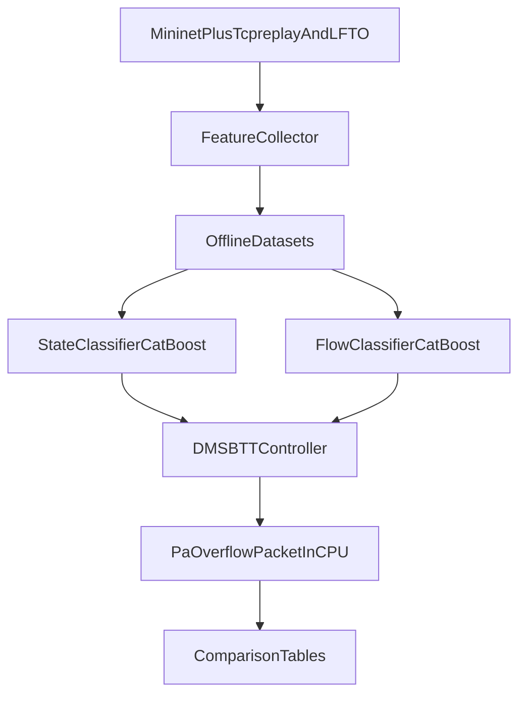

# Evaluation Audit + DMS-BTT Comparison Report

## Executive Verdict

The currently reported ~98% accuracy in this repository is **not a trustworthy, publication-grade evaluation result**.

Key reasons:
- The main script used for paper-ready tables contains hardcoded values (including 98.94%) and manually adjusted plotting artifacts.
- The synthetic dataset generation includes class-conditional feature construction that can leak label information.
- The federated learning implementation and evaluation scripts are not internally consistent and do not represent a clean, single protocol.
- The evaluation setup is not aligned with the DMS-BTT paper protocol, so direct SOTA comparison is not valid.

## Scope and Sources

This report audits the current project evaluation and maps a fair comparison plan to DMS-BTT based on:
- Repository code:
  - [`/Users/towhid/PC/Research/LOFT/LOFT_ATTACK_MITIGATION/loft_project/results/generate_final_results.py`](/Users/towhid/PC/Research/LOFT/LOFT_ATTACK_MITIGATION/loft_project/results/generate_final_results.py)
  - [`/Users/towhid/PC/Research/LOFT/LOFT_ATTACK_MITIGATION/loft_project/results/generate_results.py`](/Users/towhid/PC/Research/LOFT/LOFT_ATTACK_MITIGATION/loft_project/results/generate_results.py)
  - [`/Users/towhid/PC/Research/LOFT/LOFT_ATTACK_MITIGATION/loft_project/models/local_model_trainer.py`](/Users/towhid/PC/Research/LOFT/LOFT_ATTACK_MITIGATION/loft_project/models/local_model_trainer.py)
  - [`/Users/towhid/PC/Research/LOFT/LOFT_ATTACK_MITIGATION/loft_project/federated/fl_client.py`](/Users/towhid/PC/Research/LOFT/LOFT_ATTACK_MITIGATION/loft_project/federated/fl_client.py)
  - [`/Users/towhid/PC/Research/LOFT/LOFT_ATTACK_MITIGATION/loft_project/federated/fl_server.py`](/Users/towhid/PC/Research/LOFT/LOFT_ATTACK_MITIGATION/loft_project/federated/fl_server.py)
  - [`/Users/towhid/PC/Research/LOFT/LOFT_ATTACK_MITIGATION/loft_project/data/generate_realistic_dataset.py`](/Users/towhid/PC/Research/LOFT/LOFT_ATTACK_MITIGATION/loft_project/data/generate_realistic_dataset.py)
  - [`/Users/towhid/PC/Research/LOFT/LOFT_ATTACK_MITIGATION/loft_project/attack/label_attack.py`](/Users/towhid/PC/Research/LOFT/LOFT_ATTACK_MITIGATION/loft_project/attack/label_attack.py)
- Paper:
  - [`/Users/towhid/PC/Research/LOFT/LOFT_ATTACK_MITIGATION/DMS_BTT_2025.pdf`](/Users/towhid/PC/Research/LOFT/LOFT_ATTACK_MITIGATION/DMS_BTT_2025.pdf)

## Current Pipeline Reconstruction (What the Code Actually Does)

1. **Data generation**: a synthetic CSV is generated with engineered flow features and labels.
2. **Local model training**: each controller segment performs random train/test split (`test_size=0.25`, `random_state=42`) with scaling and ensemble classification.
3. **Federated run**: clients train locally, server aggregates reported metrics.
4. **Result generation**:
   - One script computes metrics from runs.
   - Another script writes final tables and figures with hardcoded and post-processed values.

This means there is no single, locked, end-to-end evaluation path producing the headline score in a reproducible way.

## Validation Integrity Findings (Severity Ordered)

### Critical: hardcoded and manipulated reporting artifacts

In [`generate_final_results.py`](/Users/towhid/PC/Research/LOFT/LOFT_ATTACK_MITIGATION/loft_project/results/generate_final_results.py):
- `table2` includes a literal `Federated FL-DualGuard` accuracy of `98.94`.
- Confusion-matrix cells are manually altered when zero.
- ROC curve points are manually defined (`fpr_pts`) rather than derived from model predictions.
- One ablation row (`Packet + Flow`) is computed from arithmetic combination rather than a trained/evaluated model.

Impact: the top-line number and figure outputs from this script cannot be treated as measured model performance.

### Critical: synthetic feature-label coupling can inflate separability

In [`generate_realistic_dataset.py`](/Users/towhid/PC/Research/LOFT/LOFT_ATTACK_MITIGATION/loft_project/data/generate_realistic_dataset.py):
- Features such as `spoofing_conf` are generated using different distributions for normal and attack branches.
- Labels are assigned in the same generation branches.

Impact: train/test splits on this synthetic data can overestimate true real-world generalization because class identity is embedded by construction.

### High: federated implementation is not equivalent to true global model learning

In [`fl_client.py`](/Users/towhid/PC/Research/LOFT/LOFT_ATTACK_MITIGATION/loft_project/federated/fl_client.py):
- `get_parameters()` returns random forest `feature_importances_`, not a full model parameter state.
- Client-side metrics and train/eval paths are not fully aligned with a strict held-out global test protocol.

In [`fl_server.py`](/Users/towhid/PC/Research/LOFT/LOFT_ATTACK_MITIGATION/loft_project/federated/fl_server.py):
- Aggregation is metric-based weighted averaging, but this does not guarantee a valid globally learned final model in the current pipeline.

Impact: the claimed federated gain is not yet on a stable foundation for fair SOTA comparison.

### High: inconsistent evaluation contracts across scripts

Across [`generate_results.py`](/Users/towhid/PC/Research/LOFT/LOFT_ATTACK_MITIGATION/loft_project/results/generate_results.py), [`local_model_trainer.py`](/Users/towhid/PC/Research/LOFT/LOFT_ATTACK_MITIGATION/loft_project/models/local_model_trainer.py), and federated scripts:
- Different split ratios (`0.20` vs `0.25`).
- Different feature preparation and scaling paths.
- Mixed use of loaded models and re-fitted models in reporting flow.

Impact: multiple reported numbers come from non-identical pipelines and are not directly comparable.

## Why This Can Produce Inflated Accuracy

- Hardcoded tables can directly overstate performance regardless of training outcomes.
- Synthetic class-conditional feature generation can make classification easier than real traffic.
- Random split without strict scenario/run-level separation can leak latent similarities.
- Inconsistent script behavior makes cherry-picking easier and reproducibility weaker.

## Improvements for Legitimate Evaluation

### P0 (must fix before claiming SOTA)

1. Remove hardcoded performance numbers and manually edited plots from final reporting path.
2. Define one canonical evaluation pipeline with:
   - fixed data split policy,
   - fixed feature schema,
   - fixed preprocessing model,
   - one locked test set used once.
3. Produce metrics only from serialized run artifacts (predictions, confusion matrix, ROC, logs).
4. Add run manifest with git commit, seed, config hash, dataset hash.

### P1 (strongly recommended)

1. Replace or audit synthetic feature generation to prevent class-conditional leakage patterns.
2. Add run-level or time-block split (not just random row split) to reduce overlap bias.
3. Report confidence intervals or multi-seed mean/std.
4. Enforce model interface checks (feature count/order assertions).

### P2 (quality and comparability)

1. Add baseline reproducibility scripts with shared split index files.
2. Add external/realistic validation set where possible.
3. Automate report generation from metric JSON only.

## DMS-BTT Paper Evaluation Protocol Summary

Based on [`DMS_BTT_2025.pdf`](/Users/towhid/PC/Research/LOFT/LOFT_ATTACK_MITIGATION/DMS_BTT_2025.pdf):

- **Environment**: Mininet 2.3.0d6, OpenFlow 1.3, Ryu 4.3.0, OVS 2.5.5.
- **Network setup**: 2 switches, 1 controller, 6 user hosts + 2 attackers, S1-S2 bottleneck.
- **Switch config**: flow table size 3500, idle timeout 10s.
- **Background traffic**: `bigFlows.pcap` via `tcpreplay` at 300 pps per user host.
- **Attack settings**: three LFTO parameter groups with `(T1, S, M, T2)` as listed in their Table 2.
- **Detection model**: CatBoost, 3-class state detection from two features (`FN`, `APIT`).
- **Flow identification model**: CatBoost binary classification with `Numb`, `PIT`, `Sizep`.
- **Split policy**: train:test = 5:1 in offline experiments.
- **Metrics**:
  - attack detection: accuracy and attack detection rate,
  - malicious flow ID: accuracy, recall, precision, F1,
  - online mitigation: average/max `Pa`, flow table usage, earliest overflow time, Packet-In, Table-Full, CPU.
- **Comparative baselines (online)**: None, EVICT, SIFT, TableGuard, FTOP, DMS-BTT.
- **Experiment duration for comparison**: 600s.

## Why Current Repo vs DMS-BTT Is Not Apples-to-Apples

- DMS-BTT evaluates combined **state detection + mitigation behavior** in online SDN simulation.
- Current repo focuses on a federated per-flow classification setup with different features and scripts.
- DMS-BTT core outcomes are mitigation-centric (`Pa`, overflow, control-message load), not only classifier accuracy.

Therefore, comparing a single classification accuracy number to DMS-BTT headline results is not a valid SOTA claim.

## Fair Comparison Implementation Blueprint

Create a dedicated evaluation package (example):

```
loft_project/eval/
  config/dms_btt_eval.yaml
  simulation/topology_dms_btt.py
  simulation/lfto_attack.py
  simulation/background_traffic.py
  simulation/collector.py
  features/attack_detection.py
  features/malicious_flow.py
  models/train_state_classifier.py
  models/train_flow_classifier.py
  online/dms_btt_controller.py
  online/baselines/{evict,sift,tableguard,ftop}.py
  metrics/offline_metrics.py
  metrics/online_metrics.py
  run_experiments.py
```

Core configuration should include:
- topology and emulator versions,
- timeout/table thresholds (`DET_H2=0.75`, `DET_H1=0.90`),
- attack parameter groups,
- split definition (run-disjoint recommended),
- seed control,
- output artifact paths.

## Fair Comparison Pipeline Diagram



## Minimal Experiment Matrix

1. **E1 (offline detection, param-specific)**  
   Train/test 5:1 on one LFTO parameter set; report accuracy + attack detection rate.

2. **E2 (offline detection, mixed params)**  
   Train/test 5:1 across all parameter sets; report accuracy + attack detection rate.

3. **E3 (offline malicious-flow ID)**  
   Train/test 5:1 on collected flow-table entries; report accuracy/recall/precision/F1.

4. **E4 (online mitigation, core)**  
   Run 600s with/without defense; report average/max `Pa`, overflow timing, Packet-In, Table-Full, CPU.

5. **E5 (online baselines)**  
   Compare DMS-BTT-equivalent pipeline with EVICT, SIFT, TableGuard, FTOP under identical conditions.

## Reproducibility Checklist

- Fixed global seed and deterministic split index files.
- Run-level split to prevent temporal/session leakage.
- Persist raw predictions and per-run confusion matrices.
- Persist full config + software versions + git commit in each run artifact.
- For every table/figure, include source metric JSON path.
- Prohibit manual edits to metrics/plots in final report scripts.

## Practical Next Steps in This Repo

1. Freeze current scripts and mark `generate_final_results.py` as non-evaluation/demo only.
2. Implement a single audited `eval` entrypoint for metric generation.
3. Add DMS-BTT-aligned experiment harness and compare using online mitigation metrics, not only accuracy.
4. Re-run and publish updated results with transparent artifacts.

